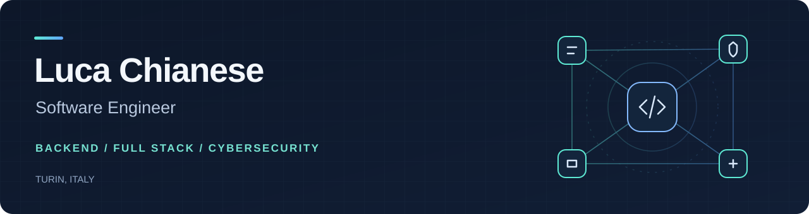

  

  <a href="https://www.linkedin.com/in/luca-chianese-9126b9198/">LinkedIn</a> &nbsp;·&nbsp;
  <a href="https://github.com/lucaboy/lucaboy/blob/main/Resume.pdf">Resume</a> &nbsp;·&nbsp;
  <a href="mailto:ing.luca.chianese@gmail.com">Get in touch</a>

### Engineering with a security perspective

I'm a software engineer based in **Turin, Italy**, working across backend systems, full-stack applications and cybersecurity.

At **Iriscube Reply**, I build **Java and Spring microservices for the banking sector**. My experience also includes cybersecurity assessments and team coordination at **EY**, full-stack development and AI integrations at **Enginius**, and several years of freelance web and hybrid app development.

### Technical toolkit

| Area | Technologies & practices |
| :--- | :--- |
| **Backend engineering** | Java · Spring · Node.js · NestJS · Express · Microservices |
| **Web & mobile** | TypeScript · JavaScript · Angular · React · Ionic · HTML · CSS |
| **AI & automation** | Python · TensorFlow · OpenAI APIs · Whisper · Prompt engineering |
| **Data** | PostgreSQL · MySQL · MongoDB |
| **Cloud & delivery** | AWS Lambda · Serverless Framework · Docker · Firebase · Git |
| **Testing & security** | Cypress · Web application penetration testing · OWASP WSTG · Burp Suite · Wireshark · Ghidra |
| **Security governance** | Cybersecurity assessments · Gap analysis · NIST CSF 2.0 · ISO 27001 · NIS2 · GDPR |

Further background

Experience and familiarity with C, C++, C#, Swift, PHP, Linux and Scrum complement my main stack.

### Selected work

| Project | Focus |
| :--- | :--- |
| **[WhatsApp Audio Transcriber](https://github.com/lucaboy/whatsapp-audio-transcriber)** | Turn voice notes into text with a reaction. TypeScript, Node.js and local Whisper inference. |
| **[SCTP Security Attacks](https://github.com/lucaboy/sctp-security-attacks)** | Python scripts for exploring SCTP security scenarios described in RFC 5062. |

### Education & publications

**Master's degree in Computer Engineering** — University of Campania Luigi Vanvitelli  
**Second-level Specializing Master in Cybersecurity** — University of Genoa  
Both awarded **110/110 with honours**.

Co-author of:

- [Exploiting LLMs for E-Learning: A Cybersecurity Perspective on AI-Generated Tools in Education](https://doi.org/10.1109/TechDefense63521.2024.10863662)
- [Leveraging Threat Modelling for Effective Penetration Testing in 5G Systems](https://doi.org/10.1109/CSR61664.2024.10679437)

---

**Let's build something useful.** Open to collaboration on software, security and applied AI.  
Italian · Native &nbsp; / &nbsp; English · Advanced
